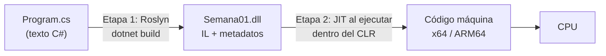
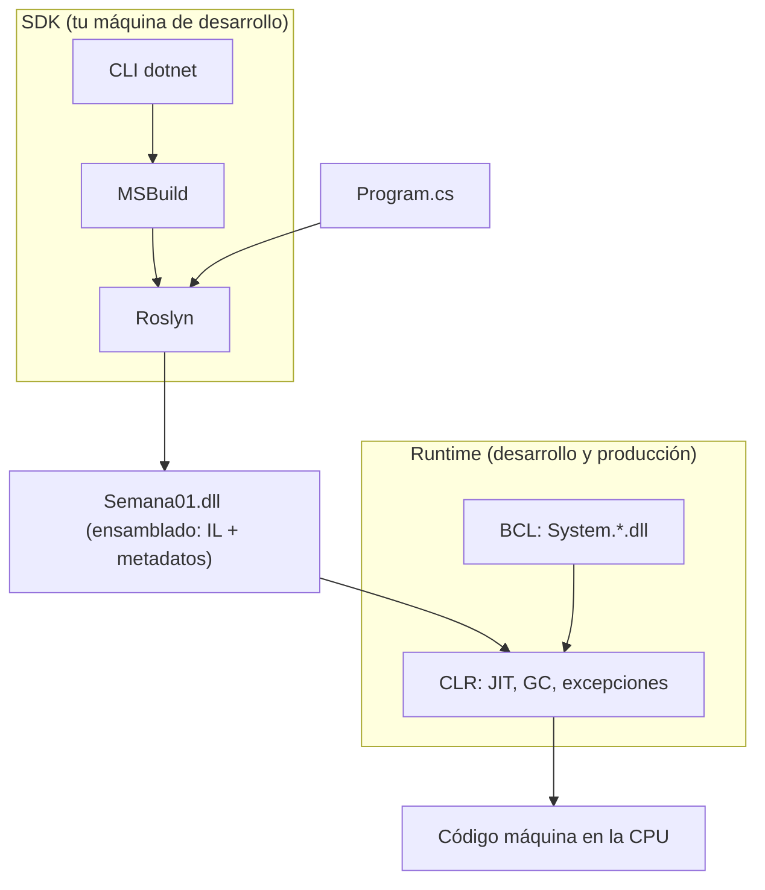

> Relacionadas: cubre la brecha "Fundamentos de C# y .NET" de [[02 Contexto y perfil]] · se lee al inicio de cada día de código del [[04 Calendario dia por dia]] · se apoya en el nivel 0 del [[05 Arbol de fundamentos]] (bits, bytes, memoria) · términos nuevos a [[08 Glosario]] · decisiones en [[01 Bitacora]] · Versión en PDF: [[10 Teoria de CSharp.pdf]]

# Teoría de C#

El [[05 Arbol de fundamentos]] explica la computadora y la web, pero no el lenguaje. Esta nota es la teoría de C# y .NET que necesitas **antes** de escribir el código de cada día. No cambia las horas de la semana: los primeros 20 minutos de cada sesión de código (martes a jueves) son lectura de la sección del día; el resto es teclado.

**Regla del plan:** aquí hay ejemplos cortos para entender cada concepto, pero no las soluciones de los ejercicios. Esos los escribes tú.

## Cómo usar esta nota

| Día | Lectura (20 min) | Código (70 min) |
| --- | --- | --- |
| Mar 6 oct | 1. Qué es .NET (ampliada, ~35 min; si no alcanza, termínala antes del miércoles) · 2. Anatomía de un proyecto · 3. Tipos (ampliada, ~35 min) | Primer proyecto por CLI, tipos, desbordamiento → laboratorio en [[12 Clase Primer proyecto por CLI]] |
| Mié 7 oct | 4. Control de flujo · 5. `double` vs. `decimal` | Ciclos y tabla de pagos |
| Jue 8 oct | 6. Métodos · 7. Convenciones | `CalcularInteres` y commit de los 5 ejercicios |

Al terminar cada sección, contesta en voz alta sus preguntas de repaso sin mirar. Si no puedes, vuelve a leerla antes de programar.

---

## 1. Qué es .NET y cómo corre tu código

Esta sección va de abajo hacia arriba: primero qué entiende la CPU, después cómo llega tu código hasta ahí, y al final cada pieza de .NET (compilador, runtime, SDK, CLI, CLR y DLL) con lo que hace en concreto. Ningún término se usa antes de explicarlo. Puede tomarte más de 20 minutos; está bien, esta sección es la base de todo lo demás.

### 1.1 Lo único que entiende la CPU: código máquina

La CPU no entiende C#, ni texto, ni palabras. Solo entiende **instrucciones**: números guardados en bytes, cada uno con un significado fijo para ese tipo de procesador. A eso se le llama **código máquina**.

Por ejemplo, en un procesador Intel o AMD (arquitectura **x64**), los dos bytes `01 D8` significan "suma el registro B al registro A". Así de pequeño es cada paso: mover un número, sumar, comparar, saltar a otra instrucción. Un programa es una lista de millones de esas instrucciones.

Dos consecuencias importantes:

1. **Cada familia de procesadores tiene su propio código máquina.** Los bytes de x64 (tu PC) no significan lo mismo en **ARM64** (un celular, una Mac reciente). Un programa en código máquina para x64 no corre en ARM64.
2. **Nadie escribe código máquina a mano.** Escribimos **código fuente** (texto en un lenguaje como C#) y algo tiene que traducirlo a código máquina.

### 1.2 Qué significa compilar

**Compilar** es traducir un programa completo de un lenguaje a otro **antes** de ejecutarlo, revisando que no tenga errores. El programa que hace eso se llama **compilador**.

**Analogía:** compilar es como traducir un libro completo antes de publicarlo. Un **intérprete**, en cambio, es como un traductor simultáneo que va traduciendo frase por frase mientras el orador habla.

Un compilador trabaja en cuatro pasos:

| Paso | Qué hace | Ejemplo con `int plazo = 12;` |
| --- | --- | --- |
| 1. Análisis léxico | Corta el texto en piezas con significado (**tokens**) | `int` · `plazo` · `=` · `12` · `;` |
| 2. Análisis sintáctico | Revisa que las piezas formen frases válidas del lenguaje | "tipo, nombre, igual, valor, punto y coma" es una declaración válida |
| 3. Análisis semántico | Revisa que tengan sentido: tipos, nombres que existan | `12` sí cabe en un `int` |
| 4. Generación de código | Escribe el resultado en el lenguaje destino | Instrucciones que guardan 12 en `plazo` |

Si escribes `int plazo = "doce";`, el paso 3 falla: no se puede guardar texto en un `int`. El compilador te da el error **CS0029** y **no genera nada**: tu programa nunca llega a correr. Esa es la gran ventaja de un lenguaje compilado:

- **Error en tiempo de compilación:** lo detecta el compilador, antes de ejecutar. Lo ves tú en Visual Studio.
- **Error en tiempo de ejecución:** aparece mientras el programa corre. Lo ve el usuario, o el cliente en producción.

**Comparación que ya conoces:** en JavaScript (tu React y Next.js) no hay un paso de compilación que revise tipos. `let plazo = "doce"; plazo * 2` corre y te da `NaN` en el navegador. En C# ese error no sale de tu máquina. TypeScript existe justamente para agregarle a JavaScript ese paso de revisión.

### 1.3 La particularidad de C#: compila dos veces

C# no compila directo a código máquina. Lo hace en **dos etapas**:



1. **Al compilar (`dotnet build`):** el compilador de C#, llamado **Roslyn**, traduce tu código a **IL** (*Intermediate Language*, lenguaje intermedio). El IL es parecido al código máquina, pero no es de ningún procesador real: es de un procesador imaginario que define .NET. Se guarda en un archivo `.dll`.
2. **Al ejecutar (`dotnet run`):** el **JIT** (*Just-In-Time compiler*, compilador "justo a tiempo") traduce el IL al código máquina del procesador donde estás corriendo, en ese momento, método por método.

**¿Por qué dos etapas y no una?**
- **Portabilidad:** la misma `.dll` corre en Windows x64, en un Linux ARM64 o en una Mac. El JIT de cada máquina hace la última traducción.
- **Optimización para la máquina real:** el JIT sabe exactamente qué CPU tienes y puede usar sus instrucciones más nuevas.
- **Metadatos:** la `.dll` guarda la descripción completa de tu código (clases, métodos, tipos). Eso permite cosas como `GetType()`, IntelliSense o la inyección de dependencias de ASP.NET Core (sección 1.7).

El costo: la primera vez que se llama cada método hay que esperar al JIT. Por eso la primera petición a una API .NET recién arrancada es más lenta que las siguientes.

### 1.4 Qué es un runtime

"Runtime" significa "tiempo de ejecución" y se usa con dos sentidos:

1. **El momento** en que el programa corre ("error en runtime" = error en tiempo de ejecución).
2. **El software que tiene que estar instalado para que un programa pueda correr.** Este es el sentido de "el runtime de .NET".

**Analogía:** un archivo `.mp4` no se reproduce solo; necesitas un reproductor de video. Tu `Semana01.dll` tampoco corre sola: tiene IL, que ninguna CPU entiende, así que necesita al runtime de .NET para traducirla y ejecutarla.

**Ancla que ya conoces:** **Node.js** es el runtime de JavaScript fuera del navegador. Cuando corres `npm run dev` en Next.js, Node.js es quien ejecuta tu código. El runtime de .NET cumple el mismo papel para C#.

**Qué contiene el runtime de .NET:**

| Pieza | Qué es | Archivo real |
| --- | --- | --- |
| El **CLR** | El motor que ejecuta tu programa (sección 1.6) | `coreclr.dll` |
| La **biblioteca base (BCL)** | Código ya escrito que tu programa usa: `Console`, `Math`, `string`, `List<T>`, `DateTime`… | Cientos de `.dll`: `System.Console.dll`, `System.Private.CoreLib.dll`… |
| El **host** | El programa que arranca todo y busca el runtime correcto | `dotnet.exe` |

**Míralo en tu máquina:** abre `C:\Program Files\dotnet\shared\Microsoft.NETCore.App\` y entra a la carpeta `10.0.x`. Vas a ver unos 200 archivos `.dll`: eso *es* el runtime. Ahí está `coreclr.dll` (el CLR) y `System.Console.dll` (donde vive el `Console.WriteLine` que usaste). En la misma carpeta `shared` hay otra llamada `Microsoft.AspNetCore.App`: el runtime extra que necesitan las APIs web. `dotnet --list-runtimes` te lista todo.

**Por qué en DiSí nunca instalaste un runtime:** las apps de DiSí usan **.NET Framework 4.x**, que viene integrado en Windows. El **.NET moderno** (5, 6, 8, 10) se instala aparte y corre también en Linux y Mac. Para publicar una API .NET 10 en IIS se instala el **Hosting Bundle**, que es el runtime más el módulo que conecta IIS con .NET.

### 1.5 Qué es el SDK y qué es una CLI

**SDK** (*Software Development Kit*, kit de desarrollo) es la caja de herramientas para **construir** programas, no solo correrlos.

**Analogía:** el runtime es el reproductor de video; el SDK es el estudio de edición completo, que además trae su propio reproductor para probar lo que editas.

| El SDK trae | Para qué |
| --- | --- |
| **Roslyn** (`csc.dll`) | Compilar C# a IL |
| **MSBuild** | El organizador de la compilación: lee tu `.csproj`, decide qué compilar, en qué orden y con qué paquetes. Visual Studio lo usa por debajo cuando presionas "Compilar" |
| **Plantillas** | Los proyectos que crea `dotnet new console` |
| **Cliente de NuGet** | Descargar paquetes (sección 1.8) |
| **La CLI `dotnet`** | Los comandos para usar todo lo anterior |
| **Un runtime** | Para correr lo que compilas |

Se instala en `C:\Program Files\dotnet\sdk\`. Ojo con los números: el SDK `10.0.100` trae el runtime `10.0.0`; numeran distinto. `dotnet --info` te muestra los dos.

**En resumen:** en tu máquina de desarrollo instalas el **SDK**; en un servidor de producción basta con el **runtime**.

#### Qué es una CLI

Hay dos formas de darle órdenes a un programa:

- **GUI** (*Graphical User Interface*): con ventanas, botones y clics. Visual Studio es una GUI.
- **CLI** (*Command Line Interface*, interfaz de línea de comandos): escribiendo comandos de texto.

La **terminal** (PowerShell) es la ventana donde escribes; la **CLI** es el programa que recibe y ejecuta lo que escribes. `dotnet` es una CLI, igual que `git` y que `npm`, que ya usas.

**Anatomía de un comando:**

| `dotnet` | `new` | `console` | `-n Semana01` |
| --- | --- | --- | --- |
| El programa (`dotnet.exe`) | El subcomando: qué acción | El argumento: sobre qué | Una opción: cómo; `-n` es la forma corta de `--name` |

**¿Para qué la CLI si existe Visual Studio?**
- **Visual Studio la usa por debajo.** El botón "Compilar" hace lo mismo que `dotnet build`. Si entiendes la CLI, entiendes qué hace el IDE por ti.
- **Se puede automatizar.** Un servidor de integración continua, como GitHub Actions en la semana 11, no tiene ventanas ni botones: solo ejecuta comandos.
- **Es igual en todos lados:** Windows, Linux, Mac, Docker.

Para explorar: `dotnet --help`, y `dotnet new --help` para ver las opciones de un subcomando.

### 1.6 El CLR: qué hace en concreto

**CLR** significa *Common Language Runtime*. Es el motor del runtime, el archivo `coreclr.dll`. Piensa en él como **el sistema operativo de tu programa**: Windows administra los programas de tu PC; el CLR administra todo lo que pasa dentro de tu programa .NET.

Esto es lo que pasa, en orden, cuando ejecutas `dotnet run` o das doble clic a `Semana01.exe`:

1. **Arranque.** El host lee `Semana01.runtimeconfig.json` para saber qué versión de runtime necesitas, la busca en `C:\Program Files\dotnet\shared\` y carga `coreclr.dll` dentro de tu proceso.
2. **Preparación de la memoria.** El CLR reserva el **heap administrado**, la zona de memoria donde vivirán tus objetos, y arranca el **recolector de basura**.
3. **Carga de ensamblados.** Abre `Semana01.dll`, lee sus metadatos y encuentra el **punto de entrada** (`Main`). Las demás `.dll` las carga hasta que las necesita: `System.Console.dll` se carga la primera vez que tu código usa `Console`.
4. **Verificación de tipos.** Revisa que el código no haga operaciones ilegales, como tratar un número como si fuera la dirección de un objeto. Por eso en C# no hay los errores de memoria corrupta típicos de C y C++.
5. **JIT.** Cada método se traduce a código máquina la primera vez que se llama, y esa traducción se reutiliza. Si un método se llama muchas veces (más de 30), el CLR lo vuelve a compilar con más optimizaciones. A esto se le llama **compilación por niveles** (*tiered compilation*).
6. **Administración de memoria.** Cada vez que creas un objeto, el CLR le da espacio en el heap. Cuando ya nadie lo usa, el **recolector de basura** (GC) lo libera. Tú nunca liberas memoria a mano. Lo verás a fondo en la semana 2.
7. **Excepciones.** Cuando algo falla (por ejemplo, la `OverflowException` del laboratorio), el CLR busca hacia atrás un `catch` que la maneje. Si no lo encuentra, termina el programa e imprime la **pila de llamadas** (*stack trace*): el camino exacto de métodos donde ocurrió.
8. **Reflexión.** Como guarda los metadatos en memoria, tu código puede preguntar "¿de qué tipo es esto?". Eso es `GetType()`, que usas en el laboratorio del martes.
9. **Hilos y código nativo.** Administra los hilos (semana 5, `async`) y permite llamar a `.dll` nativas de Windows cuando hace falta.

**En DiSí:** tus apps de .NET Framework corren dentro de `w3wp.exe`, el proceso de IIS. Ahí adentro está cargado el CLR viejo (el de .NET Framework, archivo `clr.dll`). Es el mismo concepto, otra versión del motor.

### 1.7 Qué es una DLL

**DLL** significa *Dynamic-Link Library*, biblioteca de enlace dinámico. Es una idea de Windows de los años 80:

- Una **biblioteca** es código ya escrito que otros programas reutilizan.
- **Enlace estático:** copiar ese código dentro de cada programa que lo usa. Si 50 programas lo usan, hay 50 copias, y corregir un error obliga a recompilar los 50.
- **Enlace dinámico:** el código vive en un archivo aparte (la `.dll`) y cada programa lo **carga al ejecutarse**. Una sola copia, compartida y actualizable por separado.

#### Dos tipos de DLL con la misma extensión

| | DLL nativa | DLL de .NET (ensamblado) |
| --- | --- | --- |
| Ejemplos | `kernel32.dll`, `coreclr.dll` | `Semana01.dll`, `System.Console.dll`, `Newtonsoft.Json.dll` |
| Contiene | Código máquina de un procesador | **IL + metadatos** |
| Quién la ejecuta | La CPU, directamente | El CLR, a través del JIT |
| Corre en otro sistema operativo | No | Sí, si ahí hay runtime de .NET |

A una DLL de .NET se le llama **ensamblado** (*assembly*). Las dos usan el mismo formato de archivo de Windows: **PE** (*Portable Executable*), el mismo de los `.exe`.

**Compruébalo con lo que aprendiste el lunes:** todo archivo PE empieza con los bytes `4D 5A`, que en ASCII son las letras **MZ** (las iniciales de Mark Zbikowski, el ingeniero de Microsoft que diseñó el formato en los 80). En PowerShell, desde `Semana01`:

```powershell
Format-Hex .\bin\Debug\net10.0\Semana01.dll | Select-Object -First 3
```

Vas a ver `4D 5A` al principio. Estás leyendo tu propio programa en hexadecimal.

#### Qué hay dentro de un ensamblado

| Parte | Qué guarda | Para qué sirve |
| --- | --- | --- |
| **Encabezado PE** | Que es un archivo ejecutable de Windows | Que el sistema operativo lo reconozca |
| **Encabezado CLI** | Que es código **administrado** (de .NET) | Que se sepa que lo debe ejecutar el CLR, no la CPU directo |
| **Código IL** | Tus métodos traducidos a IL | Lo que el JIT convierte en código máquina |
| **Metadatos** | Tablas con todas tus clases, métodos, parámetros y tipos, y todo lo que usas de otras `.dll` | Reflexión, IntelliSense, verificación de tipos |
| **Manifiesto** | La identidad del ensamblado: nombre, versión, cultura, firma; y la lista de ensamblados de los que depende | Que el CLR sepa qué más cargar y qué versión |
| **Recursos** | Archivos incrustados: imágenes, textos, traducciones | Llevar datos dentro del mismo archivo |

Así se ve en IL tu `Console.WriteLine("Hola")`:

```
ldstr  "Hola"                                                  // pon el texto "Hola" en la pila
call   void [System.Console]System.Console::WriteLine(string)  // llama a WriteLine, que está en System.Console.dll
ret                                                            // regresa
```

Fíjate en `[System.Console]`: el IL dice exactamente en qué ensamblado está el método. Así sabe el CLR qué `.dll` cargar. En la semana 2 abrirás tu propia `.dll` con **ILSpy** y verás esto en tu código.

#### Lo que caracteriza a un ensamblado de .NET

- **Se describe a sí mismo:** con los metadatos no necesita archivos extra para que otro programa sepa qué contiene. Por eso al agregar una referencia, Visual Studio te muestra sus clases en IntelliSense.
- **Tiene identidad con versión:** nombre + versión + cultura + firma. Dos versiones de la misma biblioteca son ensamblados distintos.
- **Es portable:** el mismo archivo sirve para cualquier sistema operativo y procesador que tenga el runtime.
- **Se carga por demanda:** el CLR lo carga hasta que se necesita, no al arrancar.
- **Tu app también es una `.dll`:** en .NET moderno, `Semana01.exe` es solo un lanzador pequeño; tu programa real es `Semana01.dll`. Prueba `dotnet bin\Debug\net10.0\Semana01.dll`: corre igual, sin el `.exe`.

**En DiSí:** la carpeta `bin` de tus apps MVC está llena de ensamblados: los tuyos y los de NuGet (`Newtonsoft.Json.dll`, etc.). ¿Has visto `<bindingRedirect>` en el `web.config`? Existe porque dos bibliotecas pedían versiones distintas del mismo ensamblado y había que decirle al CLR cuál cargar. En .NET Framework eso se llamaba el "infierno de las DLL"; el .NET moderno lo resuelve casi siempre solo.

### 1.8 Cómo encajan todas las piezas



Y las tres palabras que se confunden en entrevistas:

| Término | Qué es | Analogía |
| --- | --- | --- |
| **C#** | El lenguaje: la sintaxis y las reglas que escribes | El idioma |
| **.NET** | La plataforma completa: runtime + bibliotecas + SDK | El país donde se habla |
| **CLR** | El motor que ejecuta tu programa | El intérprete en tiempo real |

En el plan usas **.NET 10 (LTS)**, que trae **C# 14**. LTS (*Long Term Support*) significa 3 años de soporte; las versiones pares son LTS y las impares duran menos.

**NuGet** es el gestor de paquetes de .NET, como npm en JavaScript: descarga ensamblados de otros (por ejemplo, `Google.Apis.Calendar.v3` en la semana 8) y los deja disponibles para tu proyecto.

### Para comprobar en tu máquina (10 min)

1. `dotnet --info`: ubica la versión del SDK y la del runtime. ¿Son el mismo número?
2. `dotnet --list-runtimes`: ¿cuántos runtimes tienes y de qué tipo?
3. Abre `C:\Program Files\dotnet\shared\Microsoft.NETCore.App\10.0.x\` y encuentra `coreclr.dll` y `System.Console.dll`.
4. Después del laboratorio del martes: `Format-Hex` sobre tu `Semana01.dll` y encuentra `4D 5A`.
5. Ejecuta tu programa con `dotnet bin\Debug\net10.0\Semana01.dll`, sin el `.exe`.

**Preguntas de repaso**
- ¿Qué es el código máquina y por qué un programa para x64 no corre en ARM64?
- ¿Qué significa compilar? ¿Qué diferencia hay entre un error de compilación y uno de ejecución?
- ¿Por qué C# compila en dos etapas? ¿Qué ganas y qué pagas?
- ¿Qué es un runtime? Dame un ejemplo fuera de .NET.
- ¿Qué trae el SDK que no trae el runtime? ¿Qué instalas en un servidor de producción?
- ¿Qué es una CLI y por qué Visual Studio no la reemplaza?
- Cuenta qué hace el CLR desde que ejecutas tu programa hasta que imprime algo.
- ¿Qué diferencia hay entre una DLL nativa y un ensamblado de .NET? ¿Qué contiene un ensamblado?

**Tarjetas de repaso**


#flashcards/csharp/s1-plataforma-net ¿Qué es el código máquina?::Instrucciones en bytes que una familia de CPU entiende directamente; cada arquitectura (x64, ARM64) tiene el suyo <!--SR:!2026-10-20,2,190-->
#flashcards/csharp/s1-plataforma-net ¿Qué significa compilar?::Traducir el programa completo a otro lenguaje antes de ejecutarlo, revisando errores <!--SR:!2026-10-29,11,270-->
#flashcards/csharp/s1-plataforma-net ¿Error de compilación vs. de ejecución?::El de compilación lo detecta el compilador antes de correr; el de ejecución aparece mientras el programa corre <!--SR:!2026-11-02,15,290-->
#flashcards/csharp/s1-plataforma-net ¿Qué es el IL?::Intermediate Language: el lenguaje intermedio al que Roslyn compila C#; no es de ningún procesador real <!--SR:!2026-10-21,2,190-->
#flashcards/csharp/s1-plataforma-net ¿Qué es el JIT?::El compilador del CLR que traduce IL a código máquina al ejecutar, método por método, la primera vez que se llama <!--SR:!2026-10-20,2,190-->
#flashcards/csharp/s1-plataforma-net ¿Qué es un runtime?::El software que debe estar instalado para que un programa corra; en .NET: CLR + BCL + host <!--SR:!2026-10-26,8,250-->
#flashcards/csharp/s1-plataforma-net ¿Ejemplo de runtime fuera de .NET?::Node.js para JavaScript, la JVM para Java <!--SR:!2026-10-20,2,210-->
#flashcards/csharp/s1-plataforma-net ¿Qué trae el SDK?::Roslyn, MSBuild, plantillas, NuGet, la CLI dotnet y un runtime <!--SR:!2026-10-20,2,190-->
#flashcards/csharp/s1-plataforma-net ¿Qué se instala en producción, SDK o runtime?::Solo el runtime (en IIS, el Hosting Bundle) <!--SR:!2026-10-21,3,210-->
#flashcards/csharp/s1-plataforma-net ¿Qué es una CLI?::Command Line Interface: un programa que se usa con comandos de texto, como dotnet, git o npm <!--SR:!2026-10-21,3,230-->
#flashcards/csharp/s1-plataforma-net ¿Qué es MSBuild?::El organizador de la compilación: lee el .csproj y coordina compilar, resolver paquetes y copiar archivos <!--SR:!2026-10-20,1,170-->
#flashcards/csharp/s1-plataforma-net ¿Qué archivo es el CLR?::coreclr.dll (en .NET Framework, clr.dll) <!--SR:!2026-10-28,9,250-->
#flashcards/csharp/s1-plataforma-net ¿Qué es una DLL?::Dynamic-Link Library: código en un archivo aparte que los programas cargan al ejecutarse <!--SR:!2026-10-20,2,190-->
#flashcards/csharp/s1-plataforma-net ¿DLL nativa vs. ensamblado .NET?::La nativa tiene código máquina y la ejecuta la CPU; el ensamblado tiene IL + metadatos y lo ejecuta el CLR <!--SR:!2026-10-25,7,250-->
#flashcards/csharp/s1-plataforma-net ¿Qué contiene un ensamblado?::Encabezado PE, encabezado CLI, código IL, metadatos, manifiesto y recursos <!--SR:!2026-10-20,2,210-->
#flashcards/csharp/s1-plataforma-net ¿Con qué bytes empieza un .exe o .dll de Windows?::4D 5A, "MZ" en ASCII <!--SR:!2026-10-20,2,190-->
#flashcards/csharp/s1-plataforma-net ¿Qué es el manifiesto de un ensamblado?::Su identidad (nombre, versión, cultura, firma) y la lista de ensamblados de los que depende <!--SR:!2026-10-19,1,170-->

---

## 2. Anatomía de un proyecto

`dotnet new console -n Semana01` crea una carpeta con dos archivos:

**`Semana01.csproj`**: la receta del proyecto, en XML.

```xml
<Project Sdk="Microsoft.NET.Sdk">
  <PropertyGroup>
    <OutputType>Exe</OutputType>
    <TargetFramework>net10.0</TargetFramework>
    <ImplicitUsings>enable</ImplicitUsings>
    <Nullable>enable</Nullable>
  </PropertyGroup>
</Project>
```

| Línea | Qué significa |
| --- | --- |
| `Sdk="Microsoft.NET.Sdk"` | Tipo de proyecto. Una API usa `Microsoft.NET.Sdk.Web` |
| `OutputType` `Exe` | Genera un ejecutable; una biblioteca sería `Library` |
| `TargetFramework` `net10.0` | Versión de .NET contra la que compila (el TFM) |
| `ImplicitUsings` | Agrega solo los `using` comunes (`System`, `System.IO`, `System.Linq`…) |
| `Nullable` | Activa las advertencias de nulos; lo verás a fondo en la semana 4 |

En .NET Framework (lo que usas en DiSí) el `.csproj` listaba cada archivo y tenía cientos de líneas. En .NET moderno es "estilo SDK": incluye todos los `.cs` de la carpeta automáticamente.

**`Program.cs`**: una sola línea, `Console.WriteLine("Hello, World!");`. Son **top-level statements** (instrucciones de nivel superior): el compilador genera por ti la clase `Program` y el método `Main`, que es el **punto de entrada**. Un proyecto solo puede tener un archivo con top-level statements.

### Carpetas `bin` y `obj`

- **`obj/`**: archivos intermedios de la compilación (por ejemplo, `project.assets.json` con los paquetes resueltos). No se toca.
- **`bin/Debug/net10.0/`**: el resultado:
  - `Semana01.dll`: tu programa en IL.
  - `Semana01.exe`: un lanzador pequeño (apphost) que arranca el runtime y carga la `.dll`.
  - `Semana01.runtimeconfig.json`: qué versión del runtime necesita.
  - `Semana01.pdb`: símbolos de depuración (une el IL con tus líneas de código).

`bin` y `obj` **nunca van a Git**: se regeneran con cada build. `dotnet new gitignore` crea el `.gitignore` correcto en la raíz del repo.

**Debug vs. Release:** `dotnet build` compila en Debug (sin optimizar, fácil de depurar). `dotnet build -c Release` optimiza; es lo que va a producción.

### Comandos del día

| Comando | Qué hace |
| --- | --- |
| `dotnet --list-sdks` | SDKs instalados |
| `dotnet new console -n Nombre` | Proyecto nuevo de consola en la carpeta `Nombre` |
| `dotnet build` | Compila (Roslyn → IL en `bin/`) |
| `dotnet run` | Compila si hace falta y ejecuta |
| `dotnet clean` | Borra lo compilado |
| `dotnet new sln` y `dotnet sln add Semana01` | Crea una solución y le agrega el proyecto, para abrir todo `plan-dotnet` junto en Visual Studio |

**Preguntas de repaso**
- ¿Qué genera el compilador a partir de los top-level statements?
- ¿Qué hay en `bin` y qué hay en `obj`? ¿Por qué no se suben a Git?
- ¿Qué cambia entre un `.csproj` de .NET Framework y uno de .NET 10?

---

## 3. Variables y el sistema de tipos

Esta sección va de abajo hacia arriba: primero dónde vive un dato, después qué es una variable y un tipo, y al final cada tipo básico, cómo se convierten entre sí, qué pasa cuando un número no cabe y cómo se muestra un dato en pantalla. Ningún término se usa antes de explicarlo. Si no has estudiado [[11 Clase 0.1 Datos]], léela antes: aquí se usan bits, bytes y binario.

### 3.1 Dónde vive un dato: la memoria

Mientras tu programa corre, sus datos viven en la **RAM**. Imagina la RAM como una calle larguísima de casillas, todas del mismo tamaño: **cada casilla guarda 1 byte** (8 bits) y tiene un número propio, su **dirección** (casilla 1000, casilla 1001…).

Un byte solo guarda números del 0 al 255. Para guardar algo más grande (un monto de 50,000, un texto), se usan **varias casillas seguidas**.

Esto deja dos preguntas para cada dato:
1. **¿En qué casillas está?**
2. **¿Cómo se leen esos bytes?** ¿Son un número, una letra, un sí o no?

Las dos las responde la combinación de **variable** y **tipo**.

### 3.2 Qué es una variable

Una **variable** es un **nombre** que tu código le pone a un grupo de casillas de memoria, para guardar ahí un dato y usarlo después.

**Analogía:** una caja con etiqueta. La etiqueta es el nombre (`plazo`); dentro está el dato (`12`). Tú no necesitas saber en qué casilla está la caja: la buscas por su etiqueta.

```csharp
int plazo;        // 1. declarar: "reserva una caja para un número entero y llámala plazo"
plazo = 12;       // 2. asignar: "guarda 12 en la caja plazo"
int meses = 24;   // declarar y asignar en una sola línea (se llama inicializar)
plazo = meses;    // copiar: ahora plazo también vale 24
```

Tres detalles de escritura que verás en todo el código:
- Cada **instrucción** (una orden completa) termina con **punto y coma** `;`.
- Todo lo que va después de `//` es un **comentario**: una nota para personas que el compilador ignora.
- **El `=` no significa "es igual a".** Significa "guarda en la caja de la izquierda el valor de la derecha". Para *comparar* si dos cosas son iguales se usa `==` (sección 4).

### 3.3 Qué es un tipo

Los mismos bytes pueden significar cosas distintas. El byte `0100 0001` vale **65** si lo lees como número, y es la letra **A** si lo lees como letra (cada letra tiene asignado un número; lo verás en la clase 0.1 Texto). La memoria solo guarda bits: **no sabe** qué significan.

El **tipo** de una variable dice tres cosas:

| El tipo dice… | Ejemplo con `int` |
| --- | --- |
| **Cuántos bytes** ocupa | 4 bytes |
| **Cómo se leen** esos bytes | Como un número entero, con signo |
| **Qué operaciones** se permiten | Sumar, restar, comparar… pero no, por ejemplo, ponerlo en mayúsculas |

Por eso al declarar una variable siempre va primero su tipo: `int plazo` se lee "una caja de tipo `int` llamada `plazo`".

### 3.4 Estático y fuerte: el compilador vigila los tipos

C# tiene dos reglas sobre los tipos:

- **Tipado estático:** el tipo de cada variable se decide **al compilar** y **nunca cambia**. Si `plazo` es `int`, será `int` toda su vida.
- **Tipado fuerte:** no puedes guardar un dato de un tipo en una variable de otro tipo, salvo que la conversión sea segura o la pidas tú (sección 3.10).

Como el compilador conoce todos los tipos antes de ejecutar, revisa que los uses bien. Esto no compila:

```csharp
int plazo = "doce";   // error CS0029: no se puede convertir texto en int
```

Es el **error de compilación** de la sección 1.2: el programa ni siquiera se genera, así que ese error nunca llega a un cliente.

**Comparación:** una celda de Excel acepta lo que escribas; si un día pones "doce" donde iba un número, la fórmula falla después, cuando alguien abre el archivo. En C#, el error aparece en tu máquina, antes de que exista el programa.

### 3.5 `var` y `const`

```csharp
var tasa = 0.24m;              // var: el compilador deduce el tipo (decimal) por el valor
const int MesesPorAnio = 12;   // const: un valor fijo que nunca cambia
```

- **`var`** le pide al compilador que **deduzca** el tipo a partir del valor que asignas. A eso se le llama **inferencia de tipos**. **`var` no hace que la variable pueda cambiar de tipo:** el tipo se deduce una vez, al compilar, y queda fijo igual que si lo hubieras escrito. Por eso `var x;` sin valor no compila: el compilador no tendría de dónde deducirlo.
- **`const`** declara una **constante**: un valor que se conoce al escribir el código y que nunca cambia. El compilador sustituye el nombre por su valor en todos lados. Si intentas `MesesPorAnio = 13;`, no compila.

### 3.6 Los tipos básicos

Antes de la tabla, tres palabras:

- **Con signo / sin signo.** Un tipo **sin signo** usa todas sus combinaciones para números positivos: un byte va de 0 a 255. Un tipo **con signo** reserva la mitad para negativos: con 8 bits, de −128 a 127. Siguen siendo 256 combinaciones ([[11 Clase 0.1 Datos]], bloque 1).
- **Entero vs. decimal.** Un **entero** no tiene parte fraccionaria (12, −3). Un número con **decimales** sí (0.24, 15250.50).
- **Exacto vs. aproximado.** Hay tipos con decimales que guardan el valor exacto y otros que guardan una aproximación muy cercana. Por qué pasa eso y por qué importa en dinero es la sección 5; por ahora quédate con cuál es cuál.

| Tipo C# | Tipo .NET | Bytes | Qué guarda | Rango | Ejemplo en DiSí |
| --- | --- | --- | --- | --- | --- |
| `int` | `System.Int32` | 4 | Entero con signo | −2,147,483,648 a 2,147,483,647 | Plazo en meses, número de cliente |
| `long` | `System.Int64` | 8 | Entero con signo | ±9.2 × 10¹⁸ | IDs muy grandes |
| `double` | `System.Double` | 8 | Número con decimales, **aproximado** | ~15 a 17 dígitos | Cálculos científicos y gráficas |
| `decimal` | `System.Decimal` | 16 | Número con decimales, **exacto** | 28 a 29 dígitos | **Montos, tasas, intereses** |
| `bool` | `System.Boolean` | 1 | Verdadero o falso | `true` o `false` | ¿El crédito está aprobado? |
| `char` | `System.Char` | 2 | **Una** letra o símbolo | Una letra | La inicial de un nombre |
| `string` | `System.String` | Variable | Un texto: una cadena de `char` | Lo que quepa en memoria | Nombre del cliente, RFC |

**¿Por qué el máximo de `int` es 2,147,483,647?** Son 4 bytes = 32 bits = 2³² = 4,294,967,296 combinaciones. Como tiene signo, la mitad son negativas: el rango queda de −2,147,483,648 a 2,147,483,647 (2³¹ − 1; el −1 es porque el cero ocupa una de las combinaciones positivas).

**¿Por qué `char` ocupa 2 bytes y no 1?** Porque con 1 byte solo caben 256 símbolos: no alcanzan para la ñ, los acentos y los alfabetos de otros idiomas. Con 2 bytes caben 65,536. A esta forma de numerar las letras con 2 bytes se le llama **UTF-16**; la verás el sábado en la clase 0.1 Texto.

### 3.7 Nombre corto y nombre completo: el alias

Fíjate en la segunda columna de la tabla: `int` y `System.Int32` son **el mismo tipo** con dos nombres.

- **`System.Int32`** es el nombre completo del tipo, tal como existe en la biblioteca base de .NET (la BCL de la sección 1.4). La primera parte, `System`, es un **espacio de nombres** (*namespace*): una especie de **apellido** que agrupa tipos relacionados para que no se confundan con otros del mismo nombre. Es como decir "Juan Pérez" en lugar de solo "Juan".
- **`int`** es el **alias**: el apodo corto que el lenguaje C# le da a ese tipo. Es puramente de escritura: compilado, es exactamente igual.

Los tipos traen consigo datos y operaciones propias, llamados **miembros**. Se usan con un **punto**, que se lee como "de":

- `int.MaxValue` → "el valor máximo **de** `int`" → 2,147,483,647.
- `int.MinValue` → "el valor mínimo **de** `int`" → −2,147,483,648.

Como `int` es un alias de `System.Int32`, `int.MaxValue` y `Int32.MaxValue` son lo mismo.

### 3.8 Valor y referencia; texto que no cambia

La memoria de tu programa tiene dos zonas principales ([[15 Dudas resueltas]], "¿Qué es el heap?"):

- El **stack** (pila): rápido y ordenado, para las variables de cada método mientras el método corre.
- El **heap** (montón): una bodega grande para datos que pueden vivir más tiempo o cuyo tamaño no se sabe de antemano.

Eso da dos formas de guardar un dato:

| | **Tipo por valor** | **Tipo por referencia** |
| --- | --- | --- |
| Qué guarda la variable | **El dato mismo** | **La dirección** de donde está el dato, en el heap |
| Analogía | La caja contiene el objeto | La caja contiene un papelito con la dirección de una bodega |
| Tipos de la tabla | `int`, `long`, `double`, `decimal`, `bool`, `char` | `string` |

`string` es por referencia porque su tamaño es **variable**: el nombre de un cliente puede tener 4 letras o 60, y no se sabe al compilar cuánto espacio reservar.

Además, `string` es **inmutable**: una vez creado, un texto **no se modifica nunca**. Cuando "cambias" un texto, en realidad se crea uno nuevo y la variable pasa a apuntar al nuevo:

```csharp
string nombre = "alex";
nombre = nombre.ToUpper();   // no cambia "alex": crea un texto nuevo, "ALEX", y nombre apunta a él
```

La diferencia entre valor y referencia es el tema central de la semana 2.

### 3.9 Literales: valores escritos directo en el código

Un **literal** es un valor escrito tal cual en el código: el `12` de `int plazo = 12;`. El compilador decide el tipo del literal por **cómo lo escribes**:

| Escribes | Tipo del literal | Por qué |
| --- | --- | --- |
| `100` | `int` | Un entero sin nada más es `int` |
| `100L` | `long` | La `L` de *long* |
| `1.5` | `double` | Un número con punto, sin letra, es `double` |
| `1.5m` | `decimal` | La `m` de *money* (dinero). **Sin la `m`, `decimal tasa = 0.24;` no compila**, porque `0.24` es `double` |
| `1_000_000` | `int` | El guion bajo solo ayuda a leer; vale un millón |
| `0xFF` | `int` | `0x` = hexadecimal → 255 ([[11 Clase 0.1 Datos]], bloque 3) |
| `0b1010` | `int` | `0b` = binario → 10 ([[11 Clase 0.1 Datos]], bloque 2) |
| `'A'` | `char` | Comillas **simples**: una sola letra |
| `"A"` | `string` | Comillas **dobles**: un texto (aunque tenga una sola letra) |
| `true` | `bool` | Las dos únicas palabras de `bool`: `true` y `false` |

### 3.10 Convertir de un tipo a otro

A veces tienes un dato de un tipo y lo necesitas en otro. Hay tres casos.

**1. Conversión implícita (automática y segura).** Cuando el tipo destino **siempre** puede guardar el valor, el compilador convierte solo:

```csharp
int plazo = 12;
long plazoLargo = plazo;   // de int (4 bytes) a long (8 bytes): siempre cabe
```

**2. Conversión explícita o *cast* (la pides tú).** Cuando **puede perderse información**, el compilador no lo hace solo: tienes que pedirlo escribiendo el tipo destino entre paréntesis. Con eso le dices "sé que puedo perder algo, hazlo":

```csharp
double promedio = 3.99;
int entero = (int)promedio;   // 3: el cast corta los decimales, no redondea
```

**3. De texto a número.** Lo que escribe un usuario en una pantalla o en la terminal siempre llega como **texto** (`string`), aunque sean dígitos. Para convertirlo hay dos **métodos** (bloques de código con nombre que hacen una tarea; [[15 Dudas resueltas]]):

| Método | Si el texto es un número | Si no lo es (por ejemplo "doce") |
| --- | --- | --- |
| `int.Parse("12")` | Devuelve `12` | **Lanza una excepción** |
| `int.TryParse("12", out int n)` | Devuelve `true` y deja `12` en `n` | Devuelve `false` y deja `0` en `n`. No truena |

Dos palabras de esa tabla:
- **Lanzar una excepción** es la forma en que .NET avisa de un error **mientras el programa corre**. Si ninguna parte del código la atiende, el CLR detiene el programa y muestra el error (sección 1.6, paso 7). `int.Parse("doce")` lanza una `FormatException`: "el texto no tiene el formato de un número".
- **`out`**: un método normalmente regresa **un** resultado. `TryParse` necesita regresar dos: si pudo convertir (`true` o `false`) y el número. El resultado principal es el `true` o `false`; el número sale por el **parámetro `out`**, que es como una caja vacía que le prestas al método para que la llene.

**Regla:** usa `Parse` cuando el texto **ya sabes** que es un número válido (por ejemplo, uno que tu propio sistema guardó). Usa `TryParse` cuando viene de una persona, porque las personas se equivocan.

### 3.11 Desbordamiento: cuando un número no cabe

Un `int` tiene 4 bytes. ¿Qué pasa si el resultado de una suma necesita más? Para verlo en pequeño, piensa en un tipo de **1 byte con signo** (`sbyte`, de −128 a 127):

| Valor | Bits |
| --- | --- |
| 127 (el máximo) | `0111 1111` |
| 127 + 1 | `1000 0000` |

Sumar 1 a `0111 1111` da `1000 0000`: la suma binaria funciona igual que siempre. Pero en un tipo con signo, el bit de la izquierda indica el signo, y `1000 0000` **se lee como −128**. El número "dio la vuelta" del máximo al mínimo, como el odómetro de un auto que pasa de 999999 a 000000. A esta forma de representar negativos se le llama **complemento a dos**, y es la que usan casi todas las computadoras.

Con `int` pasa lo mismo, a otra escala: `int.MaxValue + 1` da **−2,147,483,648**. Esto se llama **desbordamiento** (*overflow*), y **por defecto C# no avisa**: el programa sigue con un número equivocado.

Para que sí avise, se usa la palabra **`checked`** ("revisado"):

```csharp
int maximo = int.MaxValue;
int a = maximo + 1;            // sin checked: a vale −2,147,483,648, sin aviso
int b = checked(maximo + 1);   // con checked: lanza OverflowException
```

- `checked(…)` revisa **una expresión**. Una **expresión** es cualquier combinación que produce un valor: `maximo + 1`, `plazo * 2`, `12`.
- `checked { … }` revisa **un bloque**: todas las instrucciones entre las llaves.
- **`unchecked`** es lo contrario y es el comportamiento normal: no revisar.

**La trampa de las constantes:** si escribes `int x = int.MaxValue + 1;`, sin variable de por medio, **no compila** (error CS0220). Como los dos valores son constantes conocidas al escribir el código, el compilador hace la suma él mismo, descubre que no cabe y te detiene. Para ver el desbordamiento **al ejecutar**, el valor tiene que pasar por una variable, como `maximo` en el ejemplo.

**En DiSí:** un desbordamiento silencioso en un cálculo de cartera es un monto negativo que nadie ve hasta que cuadran los números. Por eso, en cálculos donde un número podría crecer mucho, conviene usar `checked`: es preferible que el programa se detenga con un error a que siga con un dato falso.

### 3.12 Mostrar datos en pantalla con formato

En la terminal se escribe con **`Console.WriteLine`**. `Console` es un tipo de la biblioteca base que representa la ventana de la terminal, y `WriteLine` es uno de sus métodos: escribe un texto y salta a la siguiente línea.

Para meter datos dentro de un texto se usa la **interpolación**: un texto que empieza con **`$`** y lleva entre llaves `{ }` las variables que quieres mostrar:

```csharp
string nombre = "Alex";
decimal saldo = 15250.5m;
Console.WriteLine($"Hola {nombre}, tu saldo es {saldo:N2}");
// Hola Alex, tu saldo es 15,250.50
```

Después de la variable, dentro de las llaves, puedes poner un **formato** con dos puntos:

| Formato | Qué hace | `15250.5m` se ve como (en México) |
| --- | --- | --- |
| `{saldo}` | Sin formato | `15250.5` |
| `{saldo:N2}` | **N**úmero con separador de miles y 2 decimales | `15,250.50` |
| `{saldo:C}` | Moneda (*currency*) | `$15,250.50` |

**La cultura.** ¿Por qué dice "en México"? Porque los separadores y el símbolo de moneda dependen de la **cultura**: la configuración regional del sistema operativo (en Windows: Configuración → Hora e idioma → Región). Con cultura de México, `{saldo:C}` muestra `$15,250.50`; con cultura de España, el mismo código muestra `15.250,50 €`. Tu programa usa la cultura de la máquina donde corre, así que **no la des por hecha**: un servidor configurado en inglés de Estados Unidos o en España muestra los montos distinto.

### Preguntas de repaso

Antes de contestar, cuenta cuántas partes tiene cada pregunta.

- ¿`var` hace que C# sea dinámico? ¿Por qué no?
- ¿Cuántos bytes ocupa un `int` y por qué su máximo es 2,147,483,647?
- ¿Qué pasa al sumar 1 a `int.MaxValue` con y sin `checked`?
- ¿Cuándo usarías `Parse` y cuándo `TryParse`?

### Tarjetas de repaso

#flashcards/csharp/s3-tipos ¿Qué es una variable?::Un nombre para un grupo de casillas de memoria donde se guarda un dato
#flashcards/csharp/s3-tipos ¿Qué significa el = en C#?::Asignar: guarda en la variable de la izquierda el valor de la derecha. Para comparar se usa ==
#flashcards/csharp/s3-tipos ¿Qué dice el tipo de una variable?::Cuántos bytes ocupa, cómo se leen esos bytes y qué operaciones se permiten
#flashcards/csharp/s3-tipos ¿Qué es el tipado estático?::El tipo de cada variable se decide al compilar y nunca cambia
#flashcards/csharp/s3-tipos ¿Qué es el tipado fuerte?::No se guarda un dato de un tipo en otro, salvo conversión segura o pedida explícitamente
#flashcards/csharp/s3-tipos ¿var hace que la variable pueda cambiar de tipo?::No; el compilador deduce el tipo una vez, al compilar, y queda fijo
#flashcards/csharp/s3-tipos ¿Qué es una constante (const)?::Un valor conocido al escribir el código que nunca cambia; el compilador lo sustituye
#flashcards/csharp/s3-tipos ¿Por qué el máximo de int es 2,147,483,647?::32 bits = 2³² combinaciones; con signo, la mitad son negativas: el máximo es 2³¹ − 1
#flashcards/csharp/s3-tipos ¿Qué tipo se usa para dinero y por qué?::decimal, porque guarda los decimales de forma exacta
#flashcards/csharp/s3-tipos ¿Por qué char ocupa 2 bytes?::Con 1 byte solo caben 256 símbolos; con 2 caben 65,536 (UTF-16)
#flashcards/csharp/s3-tipos ¿Qué es un alias como int?::El nombre corto que C# da a un tipo de .NET: int es System.Int32
#flashcards/csharp/s3-tipos ¿Qué es un espacio de nombres (namespace)?::Un "apellido" que agrupa tipos relacionados, como System en System.Int32
#flashcards/csharp/s3-tipos ¿Tipo por valor vs. por referencia?::Por valor la variable guarda el dato; por referencia guarda la dirección del dato en el heap
#flashcards/csharp/s3-tipos ¿Qué significa que string es inmutable?::Un texto nunca se modifica; cada "cambio" crea un texto nuevo
#flashcards/csharp/s3-tipos ¿Qué es un literal?::Un valor escrito tal cual en el código, como 12, 1.5m o "Alex"
#flashcards/csharp/s3-tipos ¿Por qué decimal tasa = 0.24; no compila?::0.24 es un literal double; para decimal hay que escribir 0.24m
#flashcards/csharp/s3-tipos ¿Conversión implícita vs. cast?::Implícita: automática porque siempre cabe; cast: la pides tú porque puede perderse información
#flashcards/csharp/s3-tipos ¿Cuánto da (int)3.99?::3; el cast corta los decimales, no redondea
#flashcards/csharp/s3-tipos ¿Parse vs. TryParse?::Parse lanza excepción si el texto no es número; TryParse devuelve true o false y el número por out
#flashcards/csharp/s3-tipos ¿Qué es lanzar una excepción?::La forma en que .NET avisa de un error al ejecutar; si nadie la atiende, el programa se detiene
#flashcards/csharp/s3-tipos ¿Qué es un desbordamiento (overflow)?::Cuando el resultado no cabe en el tipo y "da la vuelta" al otro extremo, por complemento a dos
#flashcards/csharp/s3-tipos ¿Qué hace checked?::Revisa una expresión o bloque y lanza OverflowException si hay desbordamiento
#flashcards/csharp/s3-tipos ¿Por qué int.MaxValue + 1 escrito directo no compila?::Son constantes: el compilador hace la suma, ve que no cabe y da el error CS0220
#flashcards/csharp/s3-tipos ¿Qué es la interpolación de texto?::Un texto que empieza con $ y lleva variables entre llaves: $"Hola {nombre}"
#flashcards/csharp/s3-tipos ¿Qué es la cultura en .NET?::La configuración regional que define separadores y moneda; cambia cómo se ven los montos

---

## 4. Control de flujo

Una **expresión** produce un valor (`monto * tasa`); una **instrucción** ejecuta una acción (`if`, `for`, una asignación).

### Operadores

| Tipo | Operadores | Nota |
| --- | --- | --- |
| Comparación | `==` `!=` `<` `>` `<=` `>=` | Devuelven `bool` |
| Lógicos | `&&` `\|\|` `!` | `&&` y `\|\|` son de **cortocircuito**: si la izquierda ya decide, la derecha no se evalúa |
| Ternario | `condicion ? a : b` | Un `if` que produce un valor |
| Aritméticos | `+` `-` `*` `/` `%` | Entre dos `int`, `/` **descarta los decimales**: `7 / 2` da `3` |

El cortocircuito sirve para proteger: en `cliente != null && cliente.Activo`, si `cliente` es nulo nunca se evalúa `cliente.Activo`.

### Decisiones

- **`if / else if / else`:** para condiciones generales.
- **`switch` (instrucción):** para elegir entre valores fijos. Cada `case` termina en `break`.
- **`switch` expresión** (C# 8+): produce un valor y admite patrones.

```csharp
string nivel = score switch
{
    >= 700 => "Bajo riesgo",
    >= 600 => "Riesgo medio",
    _      => "Alto riesgo"     // _ es "cualquier otro caso"
};
```

Esos `>= 700` son **patrones relacionales**. Así se ven las reglas de dictaminación en C# moderno.

### Ciclos

| Ciclo | Cuándo |
| --- | --- |
| `for` | Sabes cuántas vueltas: un plazo de 12 meses |
| `while` | Repites mientras se cumpla una condición, y puede que nunca entre |
| `do / while` | Igual, pero entra al menos una vez (por ejemplo, pedir un dato hasta que sea válido) |
| `foreach` | Recorres cada elemento de una colección o un string |

`break` sale del ciclo; `continue` salta a la siguiente vuelta. Una variable declarada dentro de un bloque `{ }` solo existe dentro de él: es su **ámbito** (scope).

**Preguntas de repaso**
- ¿Qué es el cortocircuito y para qué te sirve?
- ¿Cuánto da `7 / 2` y cómo obtienes `3.5`?
- ¿Cuándo eliges `while` y cuándo `do / while`?

---

## 5. `double` vs. `decimal`: por qué el dinero va en `decimal`

`double` guarda los números en **binario**. Igual que 1/3 no se puede escribir exacto en decimal (0.3333…), 0.1 no se puede escribir exacto en binario: queda como 0.1000000000000000055… Al sumar esas pequeñas diferencias, `0.1 + 0.2` no da exactamente `0.3`. Es el estándar **IEEE 754** y pasa en casi todos los lenguajes, JavaScript incluido.

`decimal` guarda los números en **base 10**, así que 0.1 es exactamente 0.1. Es más lento y ocupa el doble, pero en dinero un centavo de diferencia en 10,000 créditos es un descuadre.

| | `double` | `decimal` |
| --- | --- | --- |
| Base | 2 | 10 |
| Precisión | ~15–17 dígitos | 28–29 dígitos |
| `0.1 + 0.2 == 0.3` | `false` | `true` |
| Dividir entre cero | Da `Infinity` | Lanza `DivideByZeroException` |
| Uso | Medidas, ciencia, gráficas | Montos, tasas, intereses |

**Para la tabla de pagos del miércoles:**

- La cuota fija de un crédito (sistema francés) es `cuota = P · i / (1 − (1 + i)^−n)`, donde `P` es el monto, `i` la tasa **mensual** (anual / 12) y `n` el número de meses. Cada mes, interés = saldo × i; abono a capital = cuota − interés; nuevo saldo = saldo − abono.
- `Math.Pow` solo trabaja con `double`. Tendrás que decidir dónde convertir entre `double` y `decimal`, y justificarlo.
- **Redondeo:** `Math.Round(x, 2)` usa por defecto el *redondeo bancario* (`MidpointRounding.ToEven`): 2.125 → 2.12. Muchos sistemas financieros esperan `MidpointRounding.AwayFromZero`: 2.125 → 2.13. Averigua cuál usa DiSí; es una gran pregunta de entrevista.

**Preguntas de repaso**
- ¿Por qué `0.1 + 0.2` no da `0.3` con `double`?
- ¿Qué ganas y qué pierdes al usar `decimal`?
- ¿Qué es el redondeo bancario?

---

## 6. Métodos

Un método es un bloque de código con nombre que recibe datos, hace algo y opcionalmente devuelve un resultado. Sirve para no repetir código y para que cada pieza tenga una sola responsabilidad.

### Firma

```csharp
static string Saludar(string nombre, bool formal = false)
{
    return formal ? $"Buen día, {nombre}" : $"Hola, {nombre}";
}
```

| Parte | En el ejemplo | Qué es |
| --- | --- | --- |
| Modificador | `static` | Pertenece al tipo, no a un objeto. Por ahora todos tus métodos serán `static`; en la semana 2 verás por qué |
| Tipo de retorno | `string` | Lo que devuelve; `void` si no devuelve nada |
| Nombre | `Saludar` | PascalCase, con un verbo |
| Parámetros | `string nombre, bool formal = false` | Datos de entrada, cada uno con su tipo |

- **Parámetro opcional:** `formal = false` tiene un valor por defecto; puedes llamar a `Saludar("Alex")`.
- **Argumento con nombre:** `Saludar(nombre: "Alex", formal: true)` hace legible una llamada con muchos parámetros.
- **Paso por valor:** el método recibe una **copia** del valor. Si cambia un parámetro `int`, la variable de quien lo llamó no cambia. `ref`, `out` e `in` cambian eso; ya usaste `out` en `TryParse`.
- **Cuerpo de expresión:** si el método es una sola expresión, puedes escribir `=> expresion;` en lugar de `{ return expresion; }`.

### Dónde viven los métodos con top-level statements

En `Program.cs` con top-level statements puedes declarar **funciones locales** debajo del código principal. Cuando el archivo crezca, lo normal es moverlas a una clase `static` propia en otro archivo, por ejemplo `Calculadora.cs`.

### Sobrecarga (overloading)

Varios métodos con el **mismo nombre** y **distinta lista de parámetros** (distinto número, tipo u orden). El compilador elige cuál llamar según los argumentos. El tipo de retorno **no** cuenta para distinguirlos. `Console.WriteLine` tiene más de 15 sobrecargas: una para `int`, otra para `string`, otra para `decimal`…

**Preguntas de repaso**
- ¿Qué partes tiene la firma de un método?
- ¿Por qué cambiar un parámetro `int` dentro de un método no cambia la variable original?
- ¿Puedes tener dos métodos que solo difieran en el tipo de retorno? ¿Por qué?

---

## 7. Convenciones de estilo

Un reclutador lee tu código antes que tu CV. Estas son las de Microsoft:

| Qué | Convención | Ejemplo |
| --- | --- | --- |
| Clases, métodos, propiedades, constantes | PascalCase | `CalcularInteres`, `MesesPorAnio` |
| Variables locales y parámetros | camelCase | `tasaAnual`, `montoTotal` |
| Campos privados | `_camelCase` | `_saldo` |
| Interfaces | `I` + PascalCase | `ICredito` (semana 3) |
| Llaves | En su propia línea (estilo Allman) | |
| Nombres | Que digan qué son, sin abreviar | `tasaMensual`, no `tm` |

---

## Preguntas de cierre de la semana

Contéstalas en voz alta, en menos de un minuto cada una, el domingo en la revisión:

1. Explica qué pasa desde que escribes `dotnet run` hasta que la CPU ejecuta tu código.
2. ¿Qué diferencia hay entre el SDK y el runtime?
3. ¿Qué es un ensamblado y qué contiene?
4. ¿Por qué el dinero se maneja en `decimal` y no en `double`?
5. ¿Qué pasa cuando un `int` se desborda y cómo lo detectas?
6. ¿Qué es la sobrecarga de métodos?

## Glosario de la semana

Pasa estos términos a [[08 Glosario]] con tu propia definición y un ejemplo de DiSí: CLR, IL, JIT, ensamblado, SDK, runtime, BCL, NuGet, top-level statements, punto de entrada, tipo por valor, tipo por referencia, inmutable, cast, overflow, `checked`, IEEE 754, redondeo bancario, cortocircuito, ámbito, firma, sobrecarga.

## Lo que viene

Cada sección se agrega aquí antes de que empiece su semana:

| Semana | Teoría de C# |
| --- | --- |
| 2 | Clases y objetos, constructores, propiedades, valor vs. referencia, `struct`, `record` |
| 3 | Interfaces, herencia, polimorfismo, clases abstractas, colecciones (`List<T>`, `Dictionary<K,V>`), genéricos |
| 4 | LINQ, excepciones (`try/catch/finally`, excepciones propias), tipos que aceptan nulos |
| 5 | `async/await`, `Task`, `HttpClient`, JSON con `System.Text.Json` |

## Recursos

- Tour de C#: https://learn.microsoft.com/dotnet/csharp/tour-of-csharp/
- Tipos integrados: https://learn.microsoft.com/dotnet/csharp/language-reference/builtin-types/built-in-types
- Comando `dotnet`: https://learn.microsoft.com/dotnet/core/tools/
- Convenciones de código: https://learn.microsoft.com/dotnet/csharp/fundamentals/coding-style/coding-conventions
